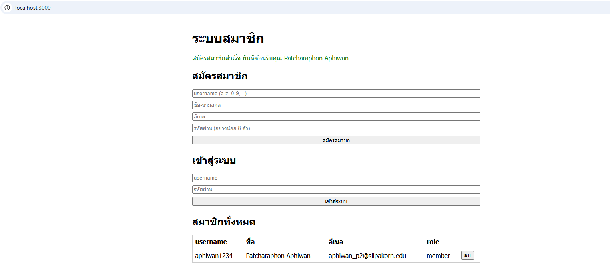
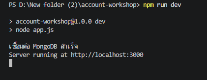
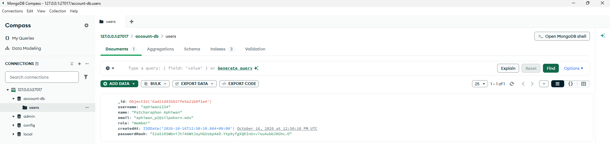

# Account Workshop

ระบบสมัครสมาชิก เข้าสู่ระบบ และจัดการสมาชิกด้วย Express.js และ MongoDB

## การติดตั้ง

npm install

## การเปิดใช้งาน

npm run dev

เข้าใช้งานผ่านเบราว์เซอร์ที่ http://localhost:3000

## API Endpoints

- GET / : หน้าเว็บหลัก
- POST /api/register : สมัครสมาชิก
- POST /api/login : เข้าสู่ระบบ
- GET /api/users : ดึงข้อมูลสมาชิกทั้งหมด
- DELETE /api/users/:id : ลบข้อมูลสมาชิกตาม ID

## ภาพหลักฐานการทำงาน

### หน้าเว็บและการทดสอบระบบ

### การเชื่อมต่อเซิร์ฟเวอร์และฐานข้อมูล

### ข้อมูลใน MongoDB Compass
